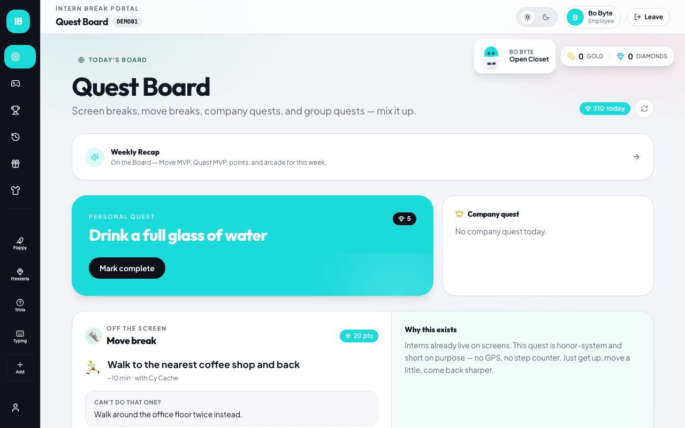
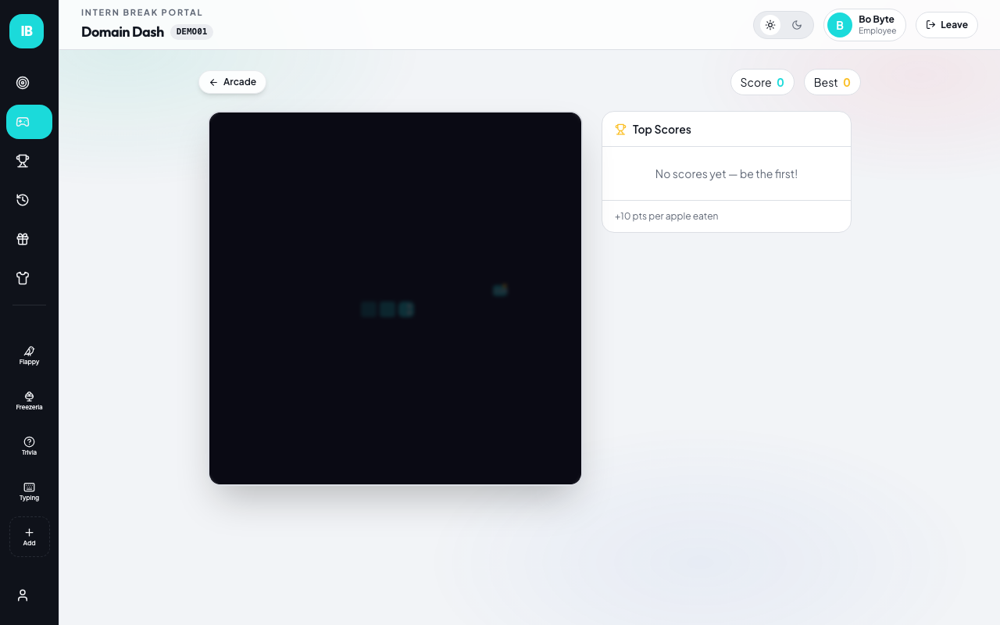
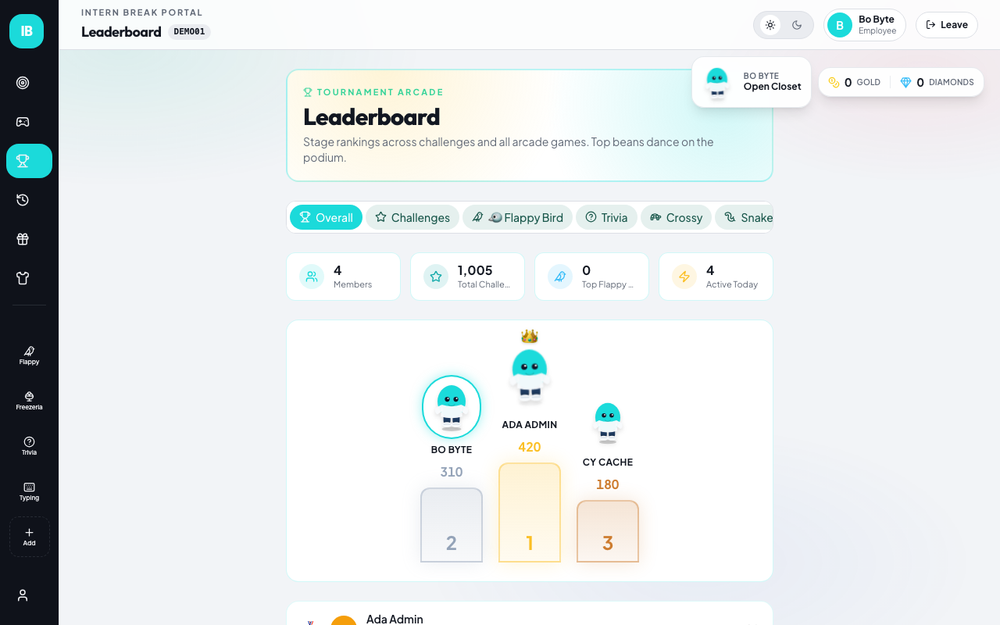
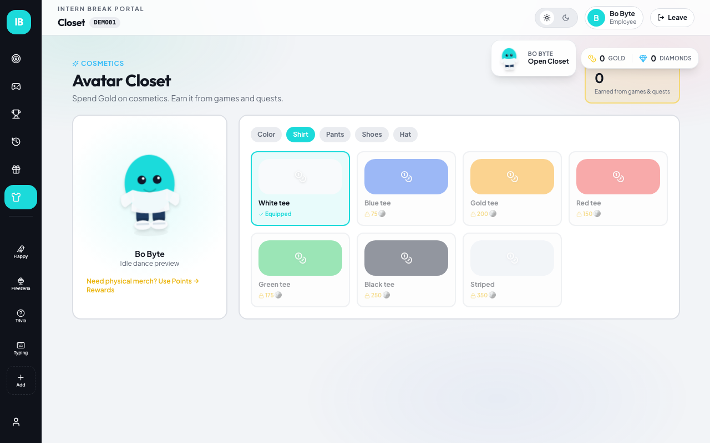
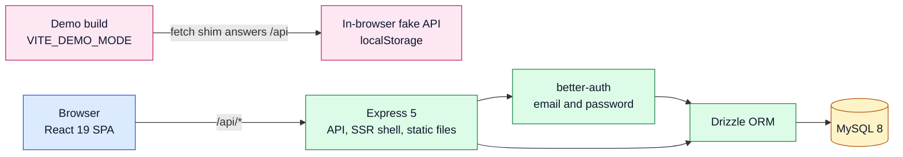

<div align="center">

# Intern Break Space

**A social arcade for internship teams: join a room, play, earn points, spend them.**


[What it does](#what-it-does) · [Try it](#try-it) · [Architecture](#architecture) · [Code](#explore-the-code) · [Develop](#api-and-development) · [Limits](#verification-and-limits)

</div>

Interns sign in, join a team room by code, and play nine mini-games between tasks. Scores turn into points and gold, which buy avatar items and rewards. Admins run the room. Typing Race is a real-time race between room members.

> [!IMPORTANT]
> **Two ways to run it.** The full app needs a server and MySQL: run it with `docker compose up --build` (see below). The static demo on GitHub Pages has no server: sign in is a local profile, data stays in your browser, the leaderboard shows labeled sample data, and Typing Race is solo practice. Live multiplayer races need the full app. The demo URL will be `https://srijjit-v.github.io/Intern-break/` once the Pages workflow has run; at the time of writing it has not.



## What it does

- Rooms by 6-character code, with roles (admin, co-admin, manager, employee). The first member of a room is its admin.
- Nine games: Flappy Bird, Papa's Freezeria, Snake, Memory Match, Trivia Blitz, Set, Crossy Road, Speed Typing, Typing Race.
- Points, gold and diamonds, an avatar shop (gold), a rewards catalog (diamonds), daily challenges, a points ledger and a leaderboard.
- Typing Race: up to 5 racers, a lobby, a countdown, live progress, finish order.
- Email and password accounts (better-auth). No email verification, so no mail provider is needed.

| Game | Leaderboard | Shop |
| --- | --- | --- |
|  |  |  |

## Try it

```bash
cp .env.example .env
# set BETTER_AUTH_SECRET (openssl rand -base64 32) and the DB passwords
docker compose up --build
docker compose run --rm migrate npx tsx scripts/seed.ts   # optional fake data
```

Open http://localhost:3000.

| Do this | Expect |
| --- | --- |
| Sign up with any email and a password with a capital, a number and a symbol | You land on your profile |
| Enter a room > Create, then open Admin | A 6-character room code and a member list |
| In a second browser, sign up and join with that code | Both of you appear on the leaderboard |
| Both open Typing Race. One presses Start Race, the other Join Live Race, then both press Ready up | A 3 second countdown on both screens, then live progress |
| Finish the passage | Results list every racer in finish order |
| Seeded accounts (`bo@example.test`, password `demo-password-123`), join room `DEMO01` | Sample members on the leaderboard |

## Architecture



More diagrams (Typing Race lifecycle, points flow) are in [docs/architecture.md](docs/architecture.md).

## Engineering highlights

| Concern | Implementation |
| --- | --- |
| Runs anywhere | DB and auth config from env vars; Nomad file only as a fallback; optional TLS |
| Schema | Drizzle migrations in `drizzle/`, applied by `npm run db:migrate`; CI fails on schema drift |
| Real-time race | Server-side state machine (lobby, countdown, active, finished), clients poll every second |
| Authorization | Roles decided server-side; races private to room members; atomic reward debit |
| Demo mode | `fetch` shim and local session at the edges; no page changes; zero `/api` requests |
| Containers | Multi-stage Node 22 image, non-root, health check; compose with MySQL 8 and a migration step |
| Tests | Unit (Vitest), full-stack and demo e2e (Playwright) including a two-browser race |

## Explore the code

- [src/server/entry.ts](src/server/entry.ts): Express app, SSR, static files
- [src/server/api/races/POST.ts](src/server/api/races/POST.ts): Typing Race state machine
- [src/server/api/company/POST.ts](src/server/api/company/POST.ts): rooms, points sync, rewards
- [src/server/db/config.ts](src/server/db/config.ts): environment-driven DB config
- [src/server/db/schema.ts](src/server/db/schema.ts): tables
- [src/lib/demo/fake-api.ts](src/lib/demo/fake-api.ts): the in-browser API used by the demo
- [src/lib/ibs-store.ts](src/lib/ibs-store.ts): client-side points and scores
- [tests/e2e/full/cross-play.spec.ts](tests/e2e/full/cross-play.spec.ts): the two-user race test

## API and development

Node 22+ and Docker. Full guide: [docs/development.md](docs/development.md). Routes: [docs/api.md](docs/api.md). Hosting: [docs/deployment.md](docs/deployment.md).

```bash
npm ci
npm run lint && npm run type-check && npx vitest run
npm run build && npm start         # needs DB_* and BETTER_AUTH_* in the environment
npm run build:pages                # static demo in dist/pages
npx playwright test --project=full # against a running app on :3000
```

## Verification and limits

Measured on 2026-11-12 on a Mac with Node 24, MySQL 8.4 (local, not Docker):

- Lint: 0 errors, 26 warnings. Type-check: clean. Unit tests: 82 passed.
- Full-stack e2e: 18 passed (auth, rooms, every page and game loading, shop and rewards, admin, a two-user typing race from lobby to results, wrong room code, server-down state, API authorization).
- Demo e2e: 5 passed (no `/api` requests, no failed responses, deep link refresh, sample room, trivia).
- Bugs found and fixed: [docs/verification/bugs.md](docs/verification/bugs.md). Baseline before the work: [docs/verification/baseline.md](docs/verification/baseline.md).

Not done or not verified:

- `docker compose up --build` worked earlier in this work, but Docker Desktop failed afterwards (disk full), so compose was not re-run on the final code.
- CI has not run on GitHub yet. The Pages workflow has not run, so the demo URL is not live.
- No public full-stack deployment. [docs/deployment.md](docs/deployment.md) describes Railway; nothing is deployed.
- Games were checked to load and start. Only Trivia (one answer) and Typing Race were played through; Flappy, Freezeria, Snake, Memory, Set, Crossy and Typing were not played to a saved score by the tests.
- Points are client-authoritative: a player can inflate their own. The next person to join an empty room becomes its admin.
- React error #419 appears in the console on some pages (lazy routes under `renderToString`); pages still work.
- The client bundle still has large chunks; no performance work was done.
- Mermaid diagrams were not checked on GitHub's renderer.

## License

This project is currently unlicensed for external use: all rights reserved.
