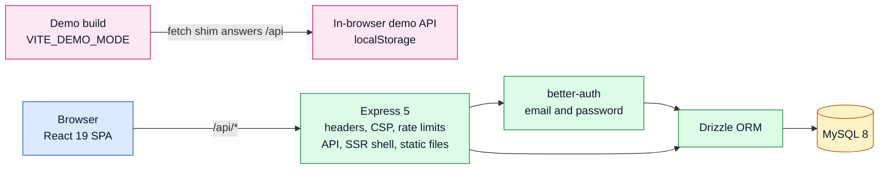
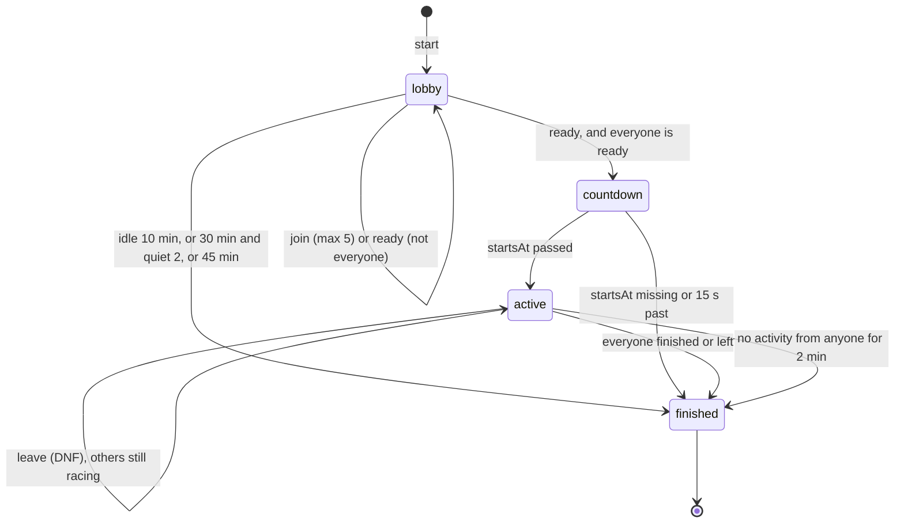
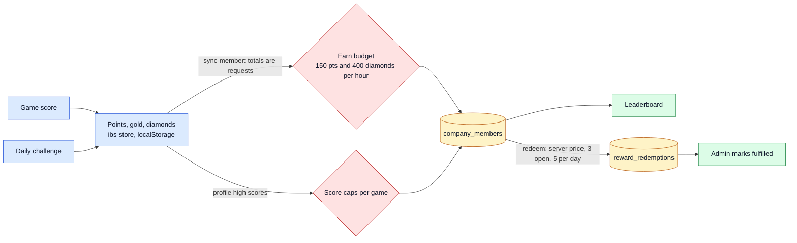
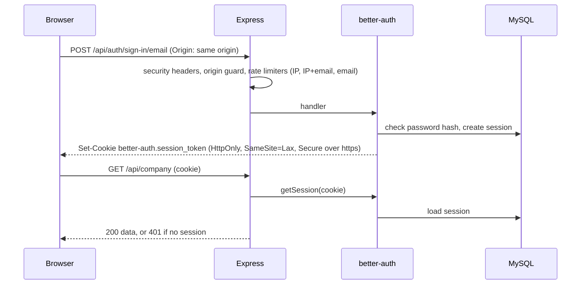
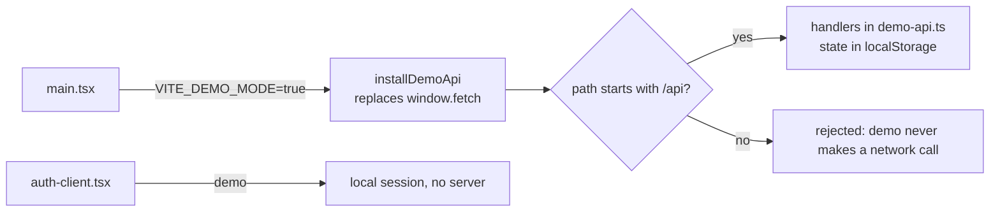

# Architecture

One Express process serves the API, the server-rendered shell and the built client. MySQL holds accounts, rooms, members, races and the earn log. Points, scores and avatar state are also kept in the browser (`src/lib/ibs-store.ts`) and synced to the server, which caps them (see [SECURITY.md](SECURITY.md)).

## System

## Typing Race state machine

Event transitions are in `src/server/api/races/POST.ts`; time- and data-driven ones are one pure function, `advanceRace()` in `src/server/race-rules.ts`, applied on every read. Clients poll `GET /api/races` every second.

| From | Event or condition | To | Test |
| --- | --- | --- | --- |
| (none) | `start` by a room member | lobby | `race-lifecycle.spec.ts` "start -> lobby" |
| lobby | `join` (not full, not started) | lobby | same, plus "a sixth racer is rejected" |
| lobby | `ready`, not everyone ready | lobby | "start -> lobby, join ..." |
| lobby | `ready`, everyone ready | countdown (starts in 3 s) | same |
| lobby | abandoned | finished | `race-rules.test.ts`, "an abandoned lobby closes" |
| countdown | `startsAt` passed | active | `race-rules.test.ts`, lifecycle spec |
| countdown | missing or 15 s past `startsAt` | finished | "a stale countdown closes" |
| active | `progress` | active | lifecycle spec |
| active | `leave` | active (leaver DNF, progress -1) or finished if nobody is left | "a player leaving mid-race" |
| active | all finished or left | finished | lifecycle spec |
| active | idle 2 min | finished | "a silent disconnect cannot block the room" |
| any open | `join` or `start` after countdown began | rejected 409 | "a late join is rejected" |
| any | a non-member of the room | rejected 403 | "wrong room code" |

Not a state change but covered: two races in two rooms are independent, a host leaving does not end the race, a refresh loses nothing (state lives on the server).

## Points and rewards flow

## Auth and session flow

## Demo mode

## Decisions

See [adr/](adr/): [0001](adr/0001-selective-ecc-install.md) tooling, [0002](adr/0002-points-trust-model.md) points trust, [0003](adr/0003-polling-vs-sse.md) polling, [0004](adr/0004-full-stack-hosting.md) hosting.
