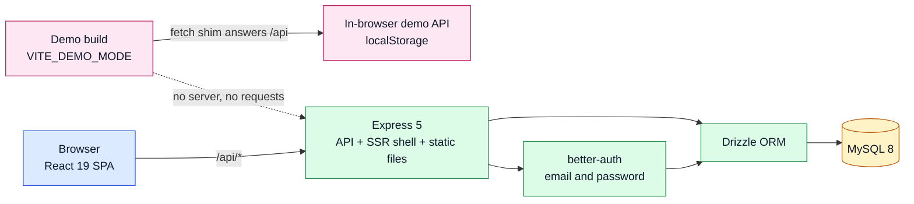
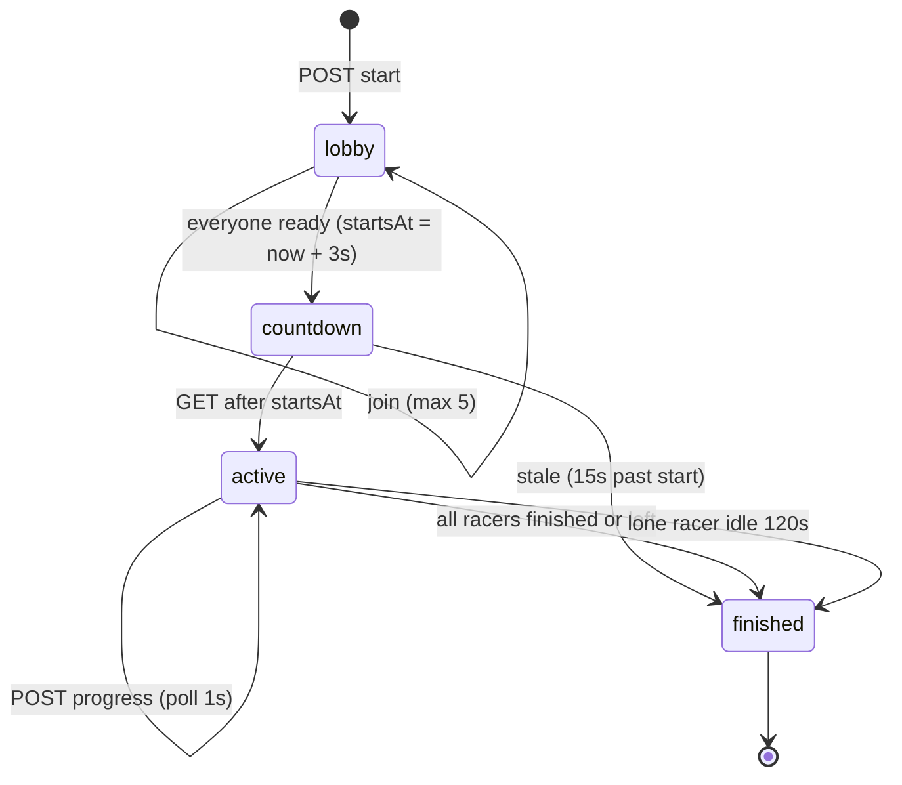
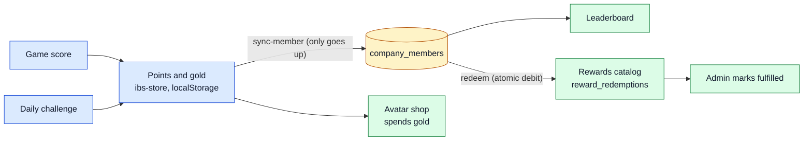

# Architecture

One Express process serves the API, the server-rendered shell and the built client. MySQL holds accounts, rooms, members and races. Points, scores and avatar state also live in the browser (`src/lib/ibs-store.ts`) and are synced to the server.

## Typing Race lifecycle

The client polls `GET /api/races` every second and posts progress; the server advances the state on each read.

## Points flow

## Key decisions

- **Roles are server-decided.** The first member of an empty room is admin; the client cannot choose a role.
- **Same origin.** better-auth uses `window.location.origin` and cookie sessions, so the API and client must share an origin.
- **Demo mode gates at the edges.** `src/lib/demo/demo-api.ts` replaces `fetch` for `/api`, and `src/lib/auth/auth-client.tsx` supplies a local session. Pages are unchanged.
